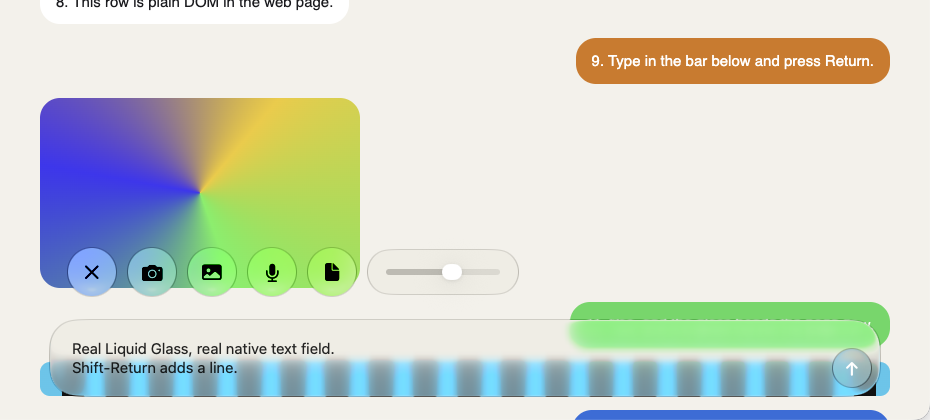
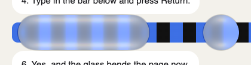
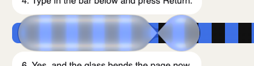
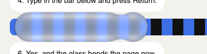
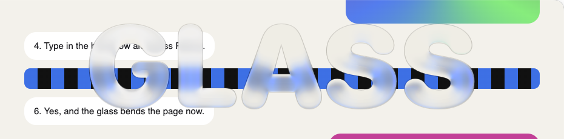
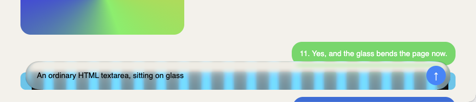
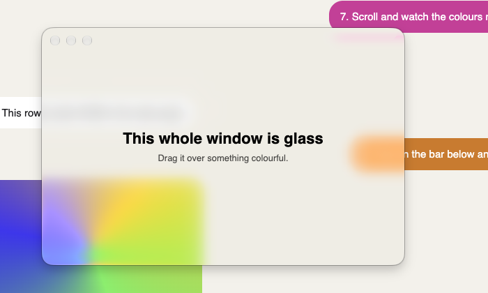
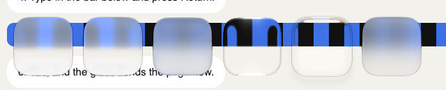

<h1 align="center">electron-glasskit</h1>

<p align="center">
  Real macOS Liquid Glass for Electron: floating over your page, merging like liquid,<br />
  and hosting native SwiftUI controls. Driven from the main process, the DOM or React.
</p>

<p align="center">
  <a href="https://www.npmjs.com/package/electron-glasskit"></a>
  <a href="https://github.com/OpenSource03/electron-glasskit/actions/workflows/ci.yml"></a>
  <a href="./LICENSE"></a>
</p>

<p align="center">
  
</p>

Everything in that picture above the chat bubbles is native: the buttons, the slider and the text field are
SwiftUI, sitting on the system's own glass, and the web page underneath shows through it.

- **Glass anywhere over your page.** Place a piece of glass at any rectangle. It refracts the live page as it scrolls.
- **Glass that merges.** Regions in a group flow into each other like droplets.
- **Native SwiftUI islands.** Describe buttons, text fields, sliders, pickers and menus as plain JSON; they render natively on glass and send events back.
- **Glass in any shape.** A capsule, a circle, an SVG path, or the outline of a word.
- **HTML on glass.** A see-through child window puts your own markup on a glass sheet that still bends the page behind it.
- **Whole-window glass** that keeps the window's shadow, rounded corners and traffic lights.
- **Driven from wherever you like:** the main process, plain DOM elements, or React components.
- **Safe everywhere.** Import it on Windows and Linux too: glass calls do nothing there and the DOM bindings fall back to CSS.

## Requirements

| | |
| --- | --- |
| Liquid Glass | macOS 26 or later |
| SwiftUI islands | macOS 14 or later (drawn on blur material before macOS 26) |
| Electron | 35 or later |
| Architectures | Apple silicon and Intel, prebuilt |

Before macOS 26, regions and the window background fall back to the classic blur. On Windows and Linux nothing
native is drawn.

## Install

```sh
npm install electron-glasskit
```

The package ships prebuilt binaries, so there is no compile step. When you package your app, keep `.node` files
outside the asar archive (electron-builder does this on its own; with Electron Forge add
`@electron-forge/plugin-auto-unpack-natives`). If you bundle your main process, mark `electron-glasskit` as external.

## Quick start

```ts
import { app, BrowserWindow } from "electron";
import { attachGlass } from "electron-glasskit";

app.whenReady().then(() => {
  const window = new BrowserWindow({ width: 900, height: 700 });
  window.loadFile("index.html");

  const glass = attachGlass(window);

  // A bar pinned to the bottom of the window. The function runs again on every resize.
  glass.addRegion({
    frame: ({ width, height }) => ({ x: 24, y: height - 80, width: width - 48, height: 56 }),
    cornerRadius: 28,
  });
});
```

Frames are in window content coordinates, in points, from the top-left corner, the same as Electron's own
rectangles.

## Glass from the DOM

Let the page decide where glass goes. An element's box is mirrored to a native piece of glass and followed
as the element moves, resizes or scrolls.

```ts
// main process
import { app, BrowserWindow, session } from "electron";
import { attachGlass, installPreload } from "electron-glasskit";

app.whenReady().then(() => {
  installPreload(session.defaultSession); // adds the bridge next to your own preload script

  const window = new BrowserWindow({ width: 900, height: 700 });
  attachGlass(window).connect(window.webContents);
  window.loadFile("index.html");
});
```

```ts
// renderer
import { bindRegion, createGroup } from "electron-glasskit/renderer";

const element = (id: string) => document.getElementById(id)!;

const toolbar = bindRegion(element("toolbar"), { cornerRadius: 16, tint: "#0a84ff22" });
toolbar.update({ style: "clear" });
toolbar.unbind();

// Regions bound with the same group merge when they come close.
const group = createGroup({ spacing: 40 });
bindRegion(element("search"), { cornerRadius: 30, group });
bindRegion(element("compose"), { cornerRadius: 30, group });
```

<p>
  
  
  
</p>

The bridge works with `contextIsolation` and `sandbox` left on. If you would rather not use `installPreload`,
set `webPreferences.preload` to the exported `preloadPath`, or `import "electron-glasskit/preload"` from your
own preload script (a sandboxed preload cannot load other files, so bundle it in that case).

Connect only pages you trust: a connected page can place glass anywhere in its window. If a page was already
loaded when you call `connect`, it is asked to send its glass again.

Where native glass is unavailable, a bound element gets a CSS stand-in (`backdrop-filter` blur). Pass
`fallback: false` to turn that off, or your own styles to replace it.

## React

```tsx
import { Glass, GlassGroup, GlassIsland, ui } from "electron-glasskit/react";

function Toolbar() {
  return (
    <GlassGroup spacing={40}>
      <Glass className="search" cornerRadius={30} />
      <Glass as="nav" className="actions" cornerRadius={30} tint="#0a84ff22" />
    </GlassGroup>
  );
}
```

`<Glass>` renders an ordinary element (a `div` unless you pass `as`), forwards its DOM props and ref, and keeps
native glass at its box. The look is set with `glassStyle`, `tint`, `cornerRadius`, `appearance`, `interactive`
and `zIndex`; `style` stays the element's CSS.

The hooks give you a ref to put on your own element:

```tsx
import { useGlassIsland, useGlassRegion } from "electron-glasskit/react";

function Sidebar() {
  const ref = useGlassRegion({ cornerRadius: 20 });
  return <aside ref={ref} className="sidebar" />;
}

function Composer() {
  const [ref, island] = useGlassIsland({ content: composer, fit: "height", onSubmit: ({ value }) => send(value) });
  return <div ref={ref} onClick={() => island.focus("message")} />;
}
```

`useGlassCapabilities()` tells a component what the system supports.

## Islands: native SwiftUI on glass

Web content cannot be drawn on top of native glass in the same window, so the things that sit *on* the glass
are native too. An island is a SwiftUI view tree described as JSON. The `ui` helpers only build plain objects.

```tsx
import { GlassIsland, ui } from "electron-glasskit/react";

const composer = ui.hstack(
  { spacing: 10, alignment: "bottom", padding: { leading: 22, trailing: 9, vertical: 9 }, glass: { shape: { type: "rect", cornerRadius: 28 } } },
  [
    ui.textField({ id: "message", placeholder: "Message", multiline: true, clearOnSubmit: true }),
    ui.button({
      id: "send",
      label: ui.symbol("arrow.up", { weight: "bold", foreground: "#fff", frame: { width: 38, height: 38 } }),
      glass: { tint: "#0a84ff", interactive: true, shape: "circle" },
    }),
  ],
);

function Composer({ onSend }: { onSend: (text: string) => void }) {
  // `fit="height"` lets the bar grow with its text; the element's height follows.
  return <GlassIsland className="composer" content={composer} fit="height" onSubmit={({ value }) => onSend(value)} />;
}
```

The text field is a real one: Return submits, Shift-Return adds a line, and typing never round-trips through
JavaScript. The same island from the main process:

```ts
const island = glass.addIsland({
  frame: ({ width, height }) => ({ x: 24, y: height - 80, width: width - 48, height: 56 }),
  content: composer,
  fit: "height",
  autoResize: { anchor: "bottom" }, // grows upward
});

island.on("submit", ({ node, value }) => console.log(node, value));
island.setValue("message", "Draft restored");
island.focus("message");
```

### Changing an island

Send a new tree and say how to get there. Glass with the same `id` morphs from its old place to its new one.

```ts
const circle = (id: string, symbol: string) =>
  ui.button({ id, label: ui.symbol(symbol, { frame: { width: 48, height: 48 } }), glass: { interactive: true, shape: "circle" } });

let open = false;
const strip = () =>
  ui.glassContainer({ spacing: 6 }, [
    ui.hstack({ spacing: 12 }, [
      circle("toggle", open ? "xmark" : "plus"),
      ...(open ? ["camera.fill", "photo.fill", "mic.fill"].map((symbol) => circle(symbol, symbol)) : []),
    ]),
  ]);

island.on("press", ({ node }) => {
  if (node !== "toggle") return;
  open = !open;
  island.setContent(strip(), { animation: "bouncy" });
});
```

Controls keep their own state between updates: a new tree only overwrites a value you changed in it.

### Nodes

| Node | What it is | Events |
| --- | --- | --- |
| `hstack` `vstack` `zstack` | Layout, with `spacing` and `alignment` | |
| `glassContainer` | Lets its glass children merge and morph | |
| `text` `symbol` `shape` `divider` `spacer` `progress` | Content. `symbol` is an SF Symbol | |
| `button` | A label (text or any node) | `press` |
| `toggle` | Switch, checkbox or button style | `change` |
| `slider` | `min`, `max`, `step` | `change` |
| `textField` | Single line or `multiline` | `change` `submit` `focus` `blur` |
| `picker` | Segmented or menu style | `change` |
| `menu` | A pull-down of items | `press` |

Every node also takes `padding`, `frame`, `font`, `foreground`, `background`, `opacity`, `hidden`, `disabled`,
`help` and `glass`. The `glass` option puts the node on Liquid Glass, in any shape:

```ts
ui.spacer({
  frame: { maxWidth: "infinity", maxHeight: "infinity" },
  glass: { shape: { type: "text", text: "GLASS", weight: "black", design: "rounded" } },
});
// also: "capsule", "circle", { type: "rect", cornerRadius }, { type: "path", d: "M0 0 L…" }
```

<p>
  
</p>

## HTML on glass: panels

When the content has to be HTML, put it in a panel: a see-through child window with a glass sheet behind its
page. The sheet samples the parent window, so the parent's page still bends through it.

```ts
const panel = glass.createPanel({
  frame: ({ width, height }) => ({ x: 24, y: height - 80, width: width - 48, height: 56 }),
  cornerRadius: 28,
});
panel.window.loadFile("composer.html"); // give this page a transparent background
```

<p>
  
</p>

`panel.window` is a normal `BrowserWindow`. The panel follows the parent as it moves and resizes, and closes
with it.

## Whole-window glass

```ts
import { attachGlass, glassWindowOptions } from "electron-glasskit";

const window = new BrowserWindow({ width: 520, height: 340, ...glassWindowOptions() });
attachGlass(window).setBackground({ tint: "#0a84ff22" });
```

<p>
  
</p>

`glassWindowOptions()` returns the window options glass needs (a transparent window with a hidden inset title
bar), so the window keeps its shadow, rounded corners and traffic lights. On systems without glass it returns
nothing, and you get an ordinary opaque window from the same code. Give the page a transparent background.

## Looks

Every region, the window background and every panel accept:

| Option | |
| --- | --- |
| `style` | `"regular"` or `"clear"` |
| `tint` | `#RGB`, `#RRGGBB` or `#RRGGBBAA`. `null` removes it |
| `cornerRadius` | In points |
| `appearance` | `"auto"`, `"light"` or `"dark"` |

Regions also take:

| Option | |
| --- | --- |
| `interactive` | System press feedback (macOS 27 and later). The region then takes clicks |
| `passthrough` | Let clicks through to the page. On by default |
| `zIndex`, `hidden` | Stacking and visibility |

The system's own material presets (dock, bubbles, loupe and 21 others) are available as `unstable_variant`,
with `unstable_scrim` and `unstable_subdued`.

<p>
  
</p>

> [!WARNING]
> The `unstable_` options use undocumented system API. They can change in any macOS update and are a risk
> for Mac App Store review. Nothing else in this package calls undocumented API.

## Capabilities

```ts
import { getCapabilities } from "electron-glasskit";

getCapabilities();
// { platform: "darwin", osVersion: "26.1.0", glass: true, fallback: false, interactiveRegions: false, islands: true }
```

The same object is available in the page from `getCapabilities()` in `electron-glasskit/renderer` and the
`useGlassCapabilities()` hook.

## API at a glance

**`electron-glasskit`** (main process)

| | |
| --- | --- |
| `attachGlass(window)` | The `GlassHost` for a window. Created once, removed with the window |
| `host.addRegion(options)` | A `GlassRegion`: `update`, `setFrame`, `remove` |
| `host.addGroup(options)` | A `GlassGroup`: `addRegion`, `update`, `remove` |
| `host.addIsland(options)` | A `GlassIsland`: `setContent`, `update`, `setValue`, `focus`, `on`, `setFrame`, `remove` |
| `host.createPanel(options)` | A `GlassPanel`: `window`, `setFrame`, `update`, `close` |
| `host.setBackground(options)` / `clearBackground()` | Glass behind the whole page |
| `host.connect(webContents \| view)` | Lets a page place glass from its DOM. Returns a disconnect function |
| `host.inspect()` / `dispose()` | Native state for debugging; remove everything |
| `getCapabilities()` `isGlassSupported()` `glassWindowOptions()` | |
| `installPreload(session)` `preloadPath` | The bridge for the renderer entry points |
| `ui` `GlassVariant` | Node builders and the material presets |

`setFrame` takes `{ animate: true }` or a duration in seconds. A page inside a `WebContentsView` that does not
fill the window is connected by passing the view, so its offset is applied.

**`electron-glasskit/renderer`**: `bindRegion`, `bindIsland`, `createGroup`, `getCapabilities`, `isAvailable`,
`refresh`, `ui`.

**`electron-glasskit/react`**: `Glass`, `GlassGroup`, `GlassIsland`, `useGlassRegion`, `useGlassIsland`,
`useGlassCapabilities`, `ui`.

All of it is typed, and every option is documented in the type definitions.

## How it works, and what to expect

Native glass views are placed in a layer directly above the window's web content. Glass samples whatever is
underneath it, so the page shows through, bent and blurred.

- **Glass on a scrolling element can lead the page by one frame.** Native views move at once; the page's own
  frame arrives a moment later. Bars that stay put on screen are unaffected. For elements moved by CSS
  animations, bind with `tracking: "frame"`.
- **Nothing from the page can be drawn above native glass in the same window.** Electron draws all web content
  of a window as one layer. Use an island for native content or a panel for HTML.
- **Docked DevTools are part of the web content,** so glass floats over them too. Undock DevTools while
  working on glass.
- **Glass belongs to the top-level page.** Messages from iframes are ignored.
- **Interactive glass takes the click.** A region with `interactive: true` reacts to presses, so they do not
  reach the page.

Tested on macOS 27 with Electron 44. The blur fallback for macOS 25 and earlier compiles but has not been run
on such a system.

## Coming from electron-liquid-glass

This project started as a fork of [electron-liquid-glass](https://github.com/Meridius-Labs/electron-liquid-glass)
and keeps its API working:

```ts
import { liquidGlass } from "electron-glasskit";

const id = liquidGlass.addView(window.getNativeWindowHandle(), { cornerRadius: 16, tintColor: "#44000010" });
```

The new way to do the same thing is `attachGlass(window).setBackground({ cornerRadius: 16, tint: "#44000010" })`.
What changed underneath:

- The glass view is created through the public API, and the view can now be updated and removed.
- The package installs on Windows and Linux instead of failing, and does nothing there.
- `glassWindowOptions()` replaces the frameless-window recipe, so traffic lights keep their position.
- Nothing is compiled on install.

## Development

```sh
pnpm install
pnpm build:all     # native addon (needs Xcode 26 or later) and the TypeScript bundles
pnpm example       # the kitchen sink: every feature in one window
pnpm test          # unit tests
pnpm test:swift    # tests for the SwiftUI renderer
pnpm test:e2e      # the real addon inside Electron
```

See [CONTRIBUTING.md](./CONTRIBUTING.md) for the layout of the code and how releases work.

## Credits and license

MIT. Built on the work of [Meridius Labs](https://github.com/Meridius-Labs), whose electron-liquid-glass showed
that this glass could be reached from Electron at all.
